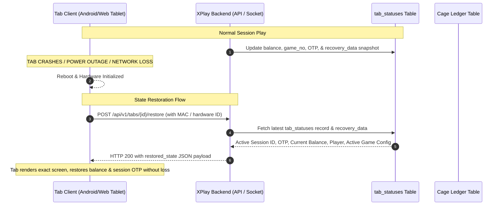

# 🎰 XPLAY — Virtuals (Tab-Based Casino Gaming System)
## Master Project Reference & Architecture Specification

> **Document Status:** Live Reference Document  
> **Last Updated:** October 2026  
> **Source Base:** Forked & adapted from `gamemgt` (Physical Table Management System)  
> **Target System:** `xplay` (Virtuals / ETG Tab-Based Casino Configuration & Resulting Engine)

---

## 📌 1. Project Overview & Background

### 1.1 The Genesis: From `gamemgt` to `xplay`
`gamemgt` was originally developed as a full-suite Casino Table Management System focused on physical gaming tables, card shoes, dealer floats, fills, credits, drop boxes, and manual ledger tracking.

`xplay` pivots this architecture into **"Virtuals"** — an **Electronic Table Game (ETG) / Tab-Based Casino Gaming System**. Instead of physical tables with chips handled at the table felt, players play on electronic touch terminals/tablets (**Tabs**), while drawing cards or spinning wheels at centralized gaming **Stations (Table IDs)**.

### 1.2 Real-World Casino Understanding: How "Virtuals" / ETGs Work
In modern land-based casinos (e.g., Macau, Las Vegas, Singapore, Goa), Tab-based ETGs solve physical constraints (table space, dealer costs, chip fraud):
1. **Central Game Station (`table_id`)**: A live or automated dealer station equipped with a smart shoe (Angel, Safeshoe) or an automated roulette wheel. A physical dealer deals real cards or a mechanical wheel spins. A hardware reader/middleware detects the drawn cards or winning number.
2. **Station Middleware**: Intercepts hardware signals (optical card readers, wheel sensors) and emits standard payload events to the central backend.
3. **Virtual Tabs (`tab_id`)**: Player-facing tablets positioned throughout the casino floor or pit arena. Multiple tabs are tied to one central station. Players place digital bets on their screen using their loaded digital chips.
4. **Cage-Centric Financial Flow**: Players do **not** transact cash or chips at the game station. All financial interactions happen at the **Cashier (Casino Cage)**:
   - Cashier deposits funds onto a Tab (`BUYIN`).
   - Cashier issues a unique session **OTP** to the player.
   - Tab is unlocked for play.
   - If player takes a break or terminal is unattended, the Tab is locked.
   - When finished, player visits Cashier for final settlement (`CASHOUT`).
5. **Real-time Resulting Engine**: When station middleware announces the cards or wheel outcome, the server computes game logic, calculates winning positions according to configured payout rules, evaluates all active tab bets, credits tab balances, and streams the results in sub-second time.

---

## 🎮 2. Games in Scope

| Game Name | Code | Current Status | Station Input | Result Calculation |
|---|---|---|---|---|
| **Baccarat** | `BAC` | Configured (inherited) | Player cards (2-3), Banker cards (2-3) | Natural wins, tableau 3rd card rules, Player/Banker/Tie, Pairs, Lucky 6 |
| **Andar Bahar** | `AB` | Configured (inherited) | Joker card, Andar cards array, Bahar cards array | First matching card on Andar or Bahar; 1st shot, Super Andar/Bahar |
| **Roulette** | `ROU` | **To be implemented** | Winning number (0–36) | Straight up, Splits, Streets, Corners, Six-line, Dozens, Columns, Red/Black, Odd/Even, High/Low |

### 2.1 Games to be Decommissioned & Removed from `gamemgt`
The following games from `gamemgt` are **out of scope** and their models, migrations, seeders, views, and controllers will be pruned:
- ❌ Dragon Tiger (`DT`)
- ❌ 3 Card Poker (`3CP`)
- ❌ Blackjack (`BJ`)
- ❌ Mini Flush (`MF`)
- ❌ Casino War (`CW`)

---

## 🏛️ 3. Core Architecture & System Modules

```mermaid
flowchart TD
    subgraph CasinoFloor["Casino Floor & Hardware"]
        Station["Central Station (Table ID)<br/>Physical Shoe / Roulette Wheel"] -->|Drawn Cards / Winning Number| Middleware["Station Middleware"]
        Tabs["Player Tabs (Tablets)<br/>Tab #1 .. Tab #N"]
    end

    subgraph MessagingLayer["High-Speed Messaging"]
        Middleware -->|Raw Station Events| Kafka["Apache Kafka Message Bus"]
        Kafka -->|Events| BackendEngine["XPlay Backend Engine (Laravel 12)"]
        BackendEngine -->|Game Outcomes & Tab Commands| Kafka
        Kafka -->|Outcomes / Status| Tabs
    end

    subgraph CashierPortal["Cashier / Cage Portal"]
        Cashier["Cashier / Cage Officer"] -->|1. Enable/Disable Tab<br/>2. Add Chips (Buyin)<br/>3. Issue Session OTP<br/>4. Lock / Unlock Tab<br/>5. Cashout Settlement| BackendEngine
    end

    subgraph Persistence["Storage & Fast Recovery"]
        BackendEngine --> DB[(MySQL / MariaDB)]
        BackendEngine --> TabStatus[("Tab Current Status Table<br/>(tab_current_status)")]
        BackendEngine --> Ledger[("Cage Ledger<br/>(BUYIN & CASHOUT only)")]
        BackendEngine --> History[("Game History & Round Results")]
    end
```

---

## 🔑 4. Feature Specifications

### 4.1 Tab Management & Cashier Configuration Portal
Replaces the old physical `Game Table Management` module.

- **Tab Entity (`tabs`)**:
  - `id` / `tab_code` (e.g., `TAB-01`, `TAB-02`)
  - `name` / `label` (e.g., "VIP Arena Tab 1")
  - `table_id` (Station binding — which live station/game this tab bets on)
  - `status` (`ENABLED`, `DISABLED`, `MAINTENANCE`)
  - `lock_status` (`LOCKED`, `UNLOCKED`)
  - `current_session_otp` (Active session verification OTP)
  - `current_balance` (Real-time digital chip balance)
  - `ip_address` / `mac_address` / `device_uuid`
- **Cashier Actions**:
  - **Enable / Disable Tab**: Admin/Cashier can take tab offline or make it available.
  - **Lock / Unlock Tab**: Prevent tampering when player takes a short break or tab is vacant.
  - **Add Chips (BUYIN)**: Cashier receives cash/chips at cage, inputs amount, system credits tab and generates player's session OTP.
  - **CASHOUT**: Cashier ends session, redeems chips/cash to player, tab balance resets to zero, session closes.
  - **Tab Configuration Settings**: Max bet, min bet, chip denomination presets selectable on tab.

### 4.2 Station Middleware & Outcome Calculation Engine
- **Station (`table_id`)**: The physical station where cards are dealt or the roulette wheel spins.
- **Middleware Integration**:
  - Pushes draw events to `/api/v1/station/result` or Kafka topic `station-events`.
  - **Payload for Baccarat**:
    ```json
    {
      "table_id": 1,
      "game": "BAC",
      "shoe_no": 42,
      "round_no": 15,
      "player_cards": ["Ah", "Kd"],
      "banker_cards": ["7s", "8c"],
      "timestamp": "2026-10-14T19:50:00Z"
    }
    ```
  - **Payload for Andar Bahar**:
    ```json
    {
      "table_id": 2,
      "game": "AB",
      "round_no": 88,
      "joker_card": "9h",
      "andar_cards": ["2c", "Kh", "9d"],
      "bahar_cards": ["3s", "Jd"],
      "timestamp": "2026-10-14T19:50:00Z"
    }
    ```
  - **Payload for Roulette**:
    ```json
    {
      "table_id": 3,
      "game": "ROU",
      "round_no": 120,
      "winning_number": 17,
      "timestamp": "2026-10-14T19:50:00Z"
    }
    ```
- **Backend Result Calculation**:
  - Computes winning outcomes (e.g. for Roulette 17: Black, Odd, Low (1-18), 2nd Dozen, 2nd Column, Street 16-17-18, etc.).
  - Evaluates all unsettled bets placed by active tabs for that station's round.
  - Calculates win amounts using configured `payout_rules`.
  - Updates each tab's credit balance atomically.
  - Records game round history.

### 4.3 Simplified Financial Ledger (Cage Buyin & Cashout Only)
- Unlike `gamemgt` (which had FILL, CREDIT, DROP, ADJUST, TABLE FLOAT), `xplay` uses a direct Cage ledger model:
  - **BUYIN**: Chips added at Cage. `tab_balance` increases.
  - **CASHOUT**: Chips redeemed at Cage. `tab_balance` zeroes out.
- No table float sessions or float balances are tracked.
- Strict idempotency via `Idempotency-Key` header to prevent double buy-in or double cashout.

### 4.4 Session Security & OTP Lifecycle
- **Session Start (BUYIN)**:
  - Cashier enters buyin amount.
  - System generates a 4 to 6-digit numeric **Session OTP** (cryptographically random).
  - Cashier hands OTP (or printed slip) to the player.
  - Player enters OTP on the Tab to unlock and begin play.
- **Session Continuity**:
  - The OTP remains the active session token throughout play until Cashout.
- **Lock / Unlock**:
  - Tab can be locked by player ("Break Mode") or locked remotely by Cashier.
  - Unlocking requires entering the valid Session OTP or Cashier override.
- **Session End (CASHOUT)**:
  - Cashout invalidates the OTP.
  - Tab is locked and reset to `IDLE` state.

### 4.5 Fast Recovery: `tab_current_status` Table
In high-volume casino operations, network interruptions, Wi-Fi drops, browser crashes, or tablet battery depletion can occur. The system must not rely on replaying ledger transactions to discover tab state.
- **`tab_current_status` Schema**:
  - `tab_id` (Primary / Unique Index)
  - `table_id` (Station linked)
  - `session_id` (UUID)
  - `session_otp` (Current active OTP)
  - `current_balance` (Decimal 12, 2)
  - `current_bet_total` (Sum of active unsettled bets in current round)
  - `status` (`IDLE`, `ACTIVE`, `LOCKED`, `DISABLED`, `OFFLINE`)
  - `lock_state` (`LOCKED`, `UNLOCKED`)
  - `last_round_id` (Last processed game round)
  - `last_heartbeat_at` (Timestamp of last tab ping)
  - `metadata` (JSON for client-state restoration: active screen, volume, theme, UI preferences)
  - `updated_at`

### 4.6 History API
RESTful API for tabs and management dashboards to retrieve game and betting history with high flexibility:
- **Endpoint**: `GET /api/v1/history/{game}`
- **Parameters**:
  - `limit` / `per_page`: Number of rows (default 20, max 100)
  - `page`: Pagination offset
  - `table_id`: Filter by station
  - `tab_id`: Filter by tab
  - `date_from` / `date_to`: Date range
  - `winner`: Filter by outcome (e.g. `P`, `B`, `T`, `17`, `RED`)
  - `sort`: `asc` or `desc` by timestamp/id

### 4.7 Kafka Integration Architecture & Strategy
- **Why Kafka?**
  - High throughput, fault-tolerant event streaming.
  - Decouples high-frequency station events, tab bets, and resulting from database persistence.
- **Topic Layout**:
  1. `station.events.raw`: Physical station pushes card readings / wheel outcomes.
  2. `game.rounds.settled`: Backend publishes resolved rounds and winning positions.
  3. `tab.bets.placed`: Tabs stream bet submissions to the engine.
  4. `tab.commands`: Cashier actions (Lock, Unlock, Buyin, Cashout, Enable, Disable).
  5. `tab.telemetry`: Heartbeats and connectivity pings.
- **Implementation in Laravel**:
  - Laravel Kafka worker daemon (`mateuscm/laravel-kafka` or `php-rdkafka`).
  - WebSocket broadcaster (Laravel Reverb / Centrifugo / Pusher) subscribed to Kafka events for instant push to Tabs without HTTP polling.

---

## 📐 5. Detailed Game Specifications: Roulette Addition

### 5.1 European Roulette (Single Zero 0–36)
- **Total Pockets**: 37 (Numbers 0 to 36).
- **Client Confirmed Payout Rules & DB Table Mapping**:

| DB `payout_id` | `game_type_id` | Bet Name (`bet_name`) | Bet Position (`bet_position`) | Client Ratio | `payout_multiplier` (DB) | Description |
|---|---|---|---|---|---|---|
| 15 | 3 | Straight Up | `STRAIGHT` | 35:1 | 35.000 | Single number (0–36) |
| 16 | 3 | Split | `SPLIT` | 17:1 | 17.000 | Two adjacent numbers |
| 17 | 3 | Street | `STREET` | 11:1 | 11.000 | Three numbers in a horizontal row |
| 18 | 3 | Corner | `CORNER` | 8:1 | 8.000 | Four numbers meeting at a corner |
| 19 | 3 | Line | `LINE` | 5:1 | 5.000 | Six numbers (two consecutive rows) |
| 20 | 3 | Column | `COLUMN` | 2:1 | 2.000 | 12 numbers in a vertical column |
| 21 | 3 | Dozen | `DOZEN` | 2:1 | 2.000 | 12 numbers (1-12, 13-24, 25-36) |
| 22 | 3 | Red | `RED` | 1:1 | 1.000 | 18 red numbers |
| 23 | 3 | Black | `BLACK` | 1:1 | 1.000 | 18 black numbers |
| 24 | 3 | Even | `EVEN` | 1:1 | 1.000 | 18 even numbers (2,4..36) |
| 25 | 3 | Odd | `ODD` | 1:1 | 1.000 | 18 odd numbers (1,3..35) |
| 26 | 3 | Low (1-18) | `LOW` | 1:1 | 1.000 | Numbers 1 through 18 |
| 27 | 3 | High (19-36) | `HIGH` | 1:1 | 1.000 | Numbers 19 through 36 |

*Note on Zero (0): When the ball lands on 0 (Green), all outside bets (Red, Black, Even, Odd, Low, High, Column, Dozen) lose according to standard European rules.*

---

## 🏛️ 6. Three-Module Architecture Specification (Implemented)

The system is organized into three distinct, specialized modules as requested by the client:

### 6.1 Module 1: `Game_Config` (`/game_configs`)
- **Controller:** [`GameConfigController`](file:///C:/xampp/htdocs/xplay/app/Http/Controllers/GameConfigController.php)
- **Primary Model:** [`GameConfig`](file:///C:/xampp/htdocs/xplay/app/Models/GameConfig.php)
- **Rules Mapping:** [`GameConfigPayoutRule`](file:///C:/xampp/htdocs/xplay/app/Models/GameConfigPayoutRule.php)
- **Purpose:** Centralized configuration of game types (`Baccarat`, `Andar Bahar`, `Roulette`), serving as default rules and betting parameters for tabs deployed across the casino floor.
- **Fields & Parameters:**
  - `name`: Human-readable identifier (e.g. "Standard European Roulette", "High Roller Baccarat").
  - `game_type_id`: Foreign key reference to `game_types`.
  - `min_bet` / `max_bet`: Pipe-separated tiered betting ranges (e.g. `10|25|50` and `500|1000|2000`).
  - `side_min_bet` / `side_max_bet`: Limit envelopes for side wagers.
  - `roulette_type`: Single Zero European (`european`), French with La Partage (`french`), or Double Zero (`american`).
  - `baccarat_6_commission`: Toggle between standard 5% commission and No-Commission (Super 6 / Banker 6 paying 50%).
  - `commission`: Numerical multiplier (e.g. `0.0500`).
  - `burn_card`: Number of cards burned before deal.
  - Specific bet envelopes: `tie_min`, `tie_max`, `pair_min`, `pair_max`, `super6_min`, `super6_max`, `andar_min`, `andar_max`, `bahar_min`, `bahar_max`.
  - `is_default`: Flag indicating if this configuration is the default template for newly created tabs.
  - `is_active`: Administrative enable/disable switch.
- **Payout Rules Overrides:** Checkboxes and multiplier override inputs dynamically mapped to [`PayoutRule`](file:///C:/xampp/htdocs/xplay/app/Models/PayoutRule.php).

---

### 6.2 Module 2: `Tab Config` (`/tabs`)
- **Controller:** [`TabController`](file:///C:/xampp/htdocs/xplay/app/Http/Controllers/TabController.php)
- **Primary Model:** [`Tab`](file:///C:/xampp/htdocs/xplay/app/Models/Tab.php) (transformed from legacy `game_tables`)
- **Multi-Game Pivot:** [`TabGameConfig`](file:///C:/xampp/htdocs/xplay/app/Models/TabGameConfig.php)
- **Status & Recovery:** [`TabStatus`](file:///C:/xampp/htdocs/xplay/app/Models/TabStatus.php)
- **Purpose:** Pure terminal/hardware entity tracking each physical tablet in the venue.
- **Fields:**
  - `tab_number`: Sequential machine number (1, 2, ... 44).
  - `table_name`: Screen display name (e.g. `Amatic-1`, `Apex-13`, `VIP-40`).
  - `ip_address`: Network IP (e.g. `192.168.1.101`).
  - `active_mac`: Hardware MAC address for binding and anti-spoofing.
  - `denomination`: Decimal ratio for credits (default `0.0100`).
  - `game_config_id`: Primary default game config assigned to the tab.
  - `tab_game_configs`: Pivot relation supporting **multiple game configs assigned to one tab** (allowing players to switch between Roulette, Baccarat, and Andar Bahar at the terminal).
  - `lock_status`: `unlocked`, `locked`, `break`.
  - `status`: 1 = enabled, 0 = disabled.
  - `connection_status`: `online`, `offline`, `disconnected`.
- **UI View (`resources/views/tabs/index.blade.php`):**
  - **Faithfully replicates mockup `WhatsApp Image 2026-09-15 at 9.28.14 PM.jpeg`**:
    - Top KPI strip: User (Cashier), Period, Time, Total In, Total Out, Difference, Total Bet, Total Win, FT In, FT Out, Bill In, Hand Pay, Credits ($514.95 in bright amber), Float: 0.00.
    - Left Jackpots card: Megapot ($9,943.82) & Tournament ($300.00).
    - Table columns: `U` (Unlock/Lock badge), `NO`, `E` (Enabled Y/N), `F` (Free Y/N), `A` (Active Y/N), `NAME`, `DENOMINATION`, `CREDITS`, `PROMO`, `LAST BET`, `GAMES`, `IN`, `OUT`, `BALANCE` (green for positive, red for negative), `BILL IN`, `FT IN`, `FT OUT`, `BET`, `CONFIG`, `ACTIONS`.

---

### 6.3 Module 3: `Dashboard` (The Cashier Cage Portal)
- **Controller:** [`DashboardController`](file:///C:/xampp/htdocs/xplay/app/Http/Controllers/DashboardController.php)
- **View:** [`dashboard.blade.php`](file:///C:/xampp/htdocs/xplay/resources/views/dashboard.blade.php)
- **Purpose:** Live cashier monitoring floor and interactive cage drawer.
- **Layout & Visual Design:**
  - **Faithfully replicates mockup `WhatsApp Image 2026-09-15 at 5.26.20 PM.jpeg`**:
    - **Top KPI Strip**: Real-time totals for Cage In, Cage Out, Gross Gaming Revenue (GGR), Drop/Transfers, Credits, Machines (42), and Active (2).
    - **7-Column Grid**: 42 responsive tab cards (rows 1–6 matching the mockup: Amatic-1 to Amatic-12, Apex-13 to Apex-27, Amatic-28 to Amatic-39, VIP-40 to VIP-44).
    - **Status Borders**:
      - `border-idle`: Bright emerald green (`#10b981`) for idle/unlocked tabs.
      - `border-active`: Glowing golden amber (`#f59e0b`) with drop shadow for active tabs with balance (Tabs #38 and #42).
      - `border-locked`: Red border (`#ef4444`) for locked / break mode tabs.
      - `border-disabled`: Muted dark slate (`#334155`).
    - **Right Sidebar**: Opening Float (0.00), Float Balance (0.00), `Day & Shift` button, `View` button (toggles to `/tabs` list view), `Logout`, and solid red `Exit` button.
- **Interactive Cashier Drawer Modal (Clicking any Tab):**
  1. **Tab Identity Banner:** Number, Name, IP, MAC, Online status, Lock status.
  2. **Live Balance & OTP:** Displays real-time balance in pure cash (no chips) and large high-visibility active session OTP.
  3. **Cashin (Buyin):** Cashier inputs amount and optional player credentials (Name, Phone, Member Card ID). Automatically generates a unique 6-digit session OTP, opens session in `tab_sessions`, sets balance in `tab_statuses`, and records `BUYIN` in `table_ledgers`.
  4. **Cashout:** Shows redeemable balance, records `CASHOUT` in `table_ledgers`, closes session in `tab_sessions`, and resets tab balance to $0.00.
  5. **Lock / Unlock:** One-click toggle between active play and Break Mode without losing the player's balance or OTP.
  6. **Cashier Side Game Config Assignment:** Cashier can assign or switch the primary `game_config_id` directly from the drawer modal.
  7. **Disaster Recovery:** Displays the active recovery snapshot and allows instant push/sync to the physical tab hardware.

---

## 🛡️ 7. Failure Management & Session Restoration System

A core client mandate is absolute resilience against hardware reboot, power outages, app crashes, and Wi-Fi drops.



- **Persistence Table:** [`tab_statuses`](file:///C:/xampp/htdocs/xplay/app/Models/TabStatus.php)
  - Updated atomically on every bet, win, buyin, and cashout.
  - Contains `recovery_data` JSON snapshot storing `tab_id`, `tab_name`, `session_id`, `otp`, `player_name`, `balance`, `game_config_id`, `timestamp`.
- **API Endpoints:**
  - `GET /api/v1/tabs/{id}/status`: Live health and state poll.
  - `POST /api/v1/tabs/{id}/restore`: Restores active session and balance immediately upon reboot.
  - `POST /api/v1/tabs/{id}/heartbeat`: Background keepalive tracking `last_seen_at`.

---

## 📅 8. Phased Implementation Roadmap

- [x] **Phase 1: Project Discovery & Reference Specification**
  - [x] Codebase audit of `gamemgt` copy.
  - [x] Analysis of casino virtuals/ETG system mechanics.
- [x] **Phase 2: Codebase Pruning & Legacy gamemgt Cleansing**
  - [x] Removed unused game models (DT, 3CP, BJ, MF, CW presets and history).
  - [x] Removed `TableFloat`, `TableFloatController`, `ShoeType`, and `ShoeTypeSeeder`.
  - [x] Removed unrun/pending migrations for deleted presets and shoe types.
  - [x] Updated seeders: `GameTypeSeeder` (BAC, AB, ROL) and `PayoutRuleSeeder` (with client-confirmed Roulette rules).
  - [x] Created core Virtuals models: `Tab`, `TabStatus`, `TabSession`, `RouletteHistory`, `RoulettePreset`.
  - [x] Cleaned all controllers, traits, and views of legacy dependencies.
- [x] **Phase 3: Module 1 (`Game_Config`) Implementation**
  - [x] Created `game_configs` and `game_config_payout_rules` database schema.
  - [x] Created `DefaultGameConfigSeeder` with standard templates for Roulette, Baccarat, and Andar Bahar.
  - [x] Built `GameConfigController` and Blade views (`index`, `create`, `edit`).
- [x] **Phase 4: Module 2 (`Tab Config`) Implementation**
  - [x] Transformed `game_tables` into `tabs` with MAC, IP, Denomination, and `tab_game_configs` multi-game assignment.
  - [x] Created `TabSeeder` seeding 42 machines matching the client screenshot.
  - [x] Built `TabController` and `resources/views/tabs/index.blade.php` matching `WhatsApp Image 2026-09-15 at 9.28.14 PM.jpeg`.
  - [x] Implemented Tab CRUD (`create`, `edit`, `store`, `update`, `destroy`, `toggleLock`, `deactivate`, `restore`, `unregisterMac`).
- [x] **Phase 5: Module 3 (`Dashboard` - Cashier Cage) Implementation**
  - [x] Built 7-column card grid in `resources/views/dashboard.blade.php` matching `WhatsApp Image 2026-09-15 at 5.26.20 PM.jpeg`.
  - [x] Configured KPI header strip (User, Period, Time, Total In, Total Out, Diff, Total Bet, Total Win, FT In, FT Out, Bill In, Credits, Machines, Active, Megapot, Tournament).
  - [x] Implemented interactive cashier drawer modal on tab card click.
  - [x] Implemented Cage Cashin (Buyin) with automatic session OTP generation.
  - [x] Implemented Cage Cashout with automatic session completion and zero-balance settlement.
  - [x] Implemented Break Mode (Lock / Unlock tab) preserving player session and OTP.
  - [x] Implemented cashier-side Game Config assignment and switching directly from dashboard.
- [x] **Phase 6: Failure Management & Disaster Recovery**
  - [x] Created `tab_statuses` table storing live balances and JSON recovery snapshots.
  - [x] Built `TabApiController` with `POST /api/v1/tabs/{id}/restore` endpoint for crash recovery.
  - [x] Created automated test suite `tests/Feature/VirtualsModulesTest.php` (7 tests, 38 assertions, 100% passing).
- [x] **Phase 7: Station Middleware Receiver, Live Resulting Engine & 156-Position Visual History Modal**
  - [x] Created `roulette_history` database table migration and updated [`RouletteHistory`](file:///C:/xampp/htdocs/xplay/app/Models/RouletteHistory.php) model.
  - [x] Implemented [`RouletteEngine`](file:///C:/xampp/htdocs/xplay/app/Services/RouletteEngine.php) supporting:
    - **156 Physical Bet Coordinates Specification:** Strictly mapped indices `0` to `156` matching hardware schematic `WhatsApp Image 2026-10-21 at 6.49.23 PM.jpeg`:
      - `0..143`: Inside grid coordinates (24 vertical coordinate columns $\times$ 6 rows: Straights, Splits, Corners, Streets, Lines, Trios, First Four).
      - `144`: Straight Up 0 (Zero pocket).
      - `145..147`: 1st Dozen (1-12), 2nd Dozen (13-24), 3rd Dozen (25-36).
      - `148..153`: Low (1-18), Even, Red, Black, Odd, High (19-36).
      - `154..156`: Column 3 (Row 1), Column 2 (Row 2), Column 1 (Row 3).
    - Multipliers: Straight Up (35:1), Split (17:1), Street (11:1), Corner (8:1), Line (5:1), Column (2:1), Dozen (2:1), Red/Black (1:1), Even/Odd (1:1), Low/High (1:1).
    - Call Bets: `0-SPIEL`, `SERIES 0/2/3`, `ORPHELINS`, `SERIES 5/8`, `CROWN`, `NEIGHBOURS`.
    - Automated bet evaluation, multi-tab resulting, and atomic `tab_statuses` balance crediting.
  - [x] Built Station Middleware Receiver & Tab Bet API ([`StationResultController`](file:///C:/xampp/htdocs/xplay/app/Http/Controllers/Api/StationResultController.php)):
    - `POST /api/v1/station/{tableId}/roulette/result`: Station middleware pushes drawn winning number (0–36) and settles round.
    - `POST /api/v1/tabs/{id}/bet`: Tab bet placement endpoint with balance & lock validations.
    - `POST /api/v1/roulette/settle`: Direct round resolution endpoint.
  - [x] Built Modal Overlay Popup History View ([`history/index.blade.php`](file:///C:/xampp/htdocs/xplay/resources/views/history/index.blade.php)):
    - Clean tabular list on `/history` matching Baccarat & Andar Bahar UX.
    - Interactive overlay popup (`modal-xl`) triggered on row click.
    - Renders the full Visual Roulette Table inside the modal with:
      - All 156 purple numbered betting dots matching `WhatsApp Image 2026-10-21 at 6.49.23 PM.jpeg`.
      - Interactive toggle: Show / Hide position numbers (0-156).
      - Casino chip markers located directly on the physical betting coordinates.
      - Animated gold halo highlighting the winning pocket.
      - Full placed bets breakdown table showing Position #, Bet Name, Rule Type, Covered Numbers, Wager, Multiplier, Outcome, and Payout Win.
  - [x] Created test suite [`RouletteResultingTest.php`](file:///C:/xampp/htdocs/xplay/tests/Feature/RouletteResultingTest.php) (5 passed, 57 assertions, 100% passing).
- [ ] **Phase 8: Kafka Real-Time Messaging Layer**
  - [ ] Deploy Kafka producers for station events, resulting, and cashier tab commands.
